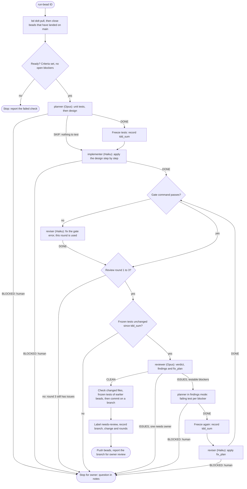

# beads-workflow

Converts Beads issues into reviewed commits, one bead at a time. The repository
owner remains the approver: the workflow never pushes code, and approval is
landing a bead's commit on main. At the start of each run it closes the
`needs-review` beads whose commit is already on main, so no bead stays open
after its work has shipped. It only syncs the beads themselves with their Dolt
remote, when one is set: it pulls before it starts and pushes before its report.

| Component | Name                            | Role                                                           |
| --------- | ------------------------------- | -------------------------------------------------------------- |
| Skill     | `/beads-workflow:run-bead <id>` | Runs a single bead                                             |
| Skill     | `/beads-workflow:run-epic <id>` | Runs every ready child of an epic, in dependency order         |
| Agent     | `beads-workflow:planner`        | Writes the failing unit tests and the detailed design (Opus)   |
| Agent     | `beads-workflow:implementer`    | Applies the design, without committing (Haiku)                 |
| Agent     | `beads-workflow:reviewer`       | Checks the acceptance criteria, then writes a fix plan (Opus)  |
| Agent     | `beads-workflow:reviser`        | Applies the reviewer's fix plan to the blockers (Haiku)        |
| Agent     | `beads-workflow:diagnoser`      | Explains why a bead broke the full suite (read-only)           |
| Agent     | `beads-workflow:epic-reviewer`  | Reviews all beads of an epic together (read-only)              |

Each bead follows the same sequence: failing tests, implementation, quality
gate, review, revision (at most three rounds), and a commit with a Conventional
Commit message on a dedicated branch named `type-short-summary`, stacked on the
previous bead. Files that only a formatter changed outside the bead go into
a separate `style(...)` commit just below it.
`run-bead` owns these per-bead steps and `run-epic` reuses them, so a change
to `run-bead` changes both.

## How a bead runs

The diagram shows one bead through `run-bead`. Rounded boxes start or stop the
run; boxes with an agent name run that agent. The review loop allows three
rounds, and any path to "Stop for owner" leaves the bead open with a question in
its notes.



The owner approves a bead by landing its branch on main. The next run closes it.

After the last bead of an epic, `run-epic` runs every gate command of the
project once on top of the stack, to catch breakage between areas that the
per-bead gates miss. A failure is reported to the owner and is not fixed
automatically. The report names the cause: the bead that introduced the failure
(found with `jj bisect` or `git bisect`), a failure that already existed before
the epic, or a flaky test. When a bead is the cause, the read-only diagnoser
explains the likely reason and suggests fixes.

When the full suite passes, the read-only epic reviewer reads all beads of the
run together and reports problems between beads that per-bead reviews miss: a
missing piece, drift from the epic's design, inconsistency, duplication, and
leftovers. Its findings go to the owner and are not fixed automatically.

## Installation

```sh
claude plugin marketplace add muzomer/plugins  # append --scope project|local when required
claude plugin install beads-workflow@muzomer    # use the same --scope value
```

## Requirements

- [`bd`](https://github.com/gastownhall/beads), written against version 1.2.2;
  `bd update --claim`, `--set-metadata` and `bd dolt pull`/`push` are required
- `jq`
- `jj` or `git`; with jj, a version that has `jj bisect run` (tested with 0.41)
- `bash`, used to run gate commands during bisect

## Project setup

Every bead requires **acceptance criteria**. Beads without acceptance criteria
are flagged for a human decision instead of being implemented.

Beads are built test-first. The planner turns each acceptance criterion into a
test and confirms it fails before any code exists, then writes a detailed design
(numbered steps with file, function and change) for the implementer to apply. It
skips beads with nothing to test. Its test files are then frozen: the workflow
records their checksum and stops the bead if the implementer or reviser changes them.

In round 1, the reviewer also reviews adversarially: it looks for bugs the
tests miss, and each blocker must name a concrete failing scenario. For each
blocker it writes a fix plan, the steps the reviser must follow. Before the
reviser fixes a blocker, the planner adds a failing test that reproduces it, so
every fix is proven by a test written by another agent.

The implementer and reviser run on Haiku, so they follow the planner's design and
the reviewer's fix plan exactly. A step that cannot be applied as written stops
the bead for the owner, rather than being improvised.

The project's root `CLAUDE.md` requires a `## Quality gates` section. The
workflow selects the row matching the area a bead touches and runs the
corresponding command after every change:

```markdown
## Quality gates

| Area   | Gate command                                   |
| ------ | ---------------------------------------------- |
| `api/` | `cd api && go test ./... && golangci-lint run` |
| `web/` | `pnpm --dir web lint && pnpm --dir web test`   |
```

When the section or the matching row is missing, the workflow requests the gate
command before starting, and offers to save the answer as a row of the table
in its own commit. Prefer quiet test flags (for example `pytest -q`): the
workflow reads only the exit code and, on a failure, the last 30 lines. Prefer
the runner's parallel mode too (`pytest -n auto`, `make -j`, or one process
per test file with `xargs -P`) when tests share no temp folders, ports or
databases: the gate runs several times per bead, so its speed adds up. Each
gate command must finish within 10 minutes: agents run it as one foreground
call with Claude Code's longest Bash timeout, and an agent whose gate takes
longer stops with `BLOCKED: gate exceeds 10 minutes`. Split a slower suite
into area rows.

The skills run the coordinator on Sonnet, because it only routes work; each
agent keeps its own model.

An optional `## Review checklist` section lists the project's own risks. The
implementer follows each item and the reviewer checks it, on top of its
generic checks (inputs, error paths, security, state, resources). The
workflow grows this list: a reviewer marks a blocker any future change could
repeat with a `rule:`, run-epic passes the rules found so far to the next
beads' implementers as known pitfalls, and the final report proposes them as
checklist items (or as a test or lint rule) for the owner to approve. Items
look like this:

```markdown
## Review checklist

- Every endpoint checks that the user belongs to the project's organisation.
- API responses stay backwards compatible: add fields, never rename or remove.
```

## Data recorded on beads

| Kind     | Name                           | Meaning                                                              |
| -------- | ------------------------------ | -------------------------------------------------------------------- |
| Label    | `needs-review`                 | Committed and awaiting review; closed once its commit lands on main  |
| Label    | `human`                        | Blocked on an owner decision; the open question is in the bead notes |
| Metadata | `gate`                         | Result of the last gate run: `pass` or `fail`                        |
| Metadata | `findings`                     | Current review findings or gate error; removed when review is clean |
| Metadata | `fix_plan`                     | Steps the reviser follows for each blocker; removed when review is clean |
| Field    | `design`                       | Detailed steps the implementer applies, written by the planner               |
| Metadata | `verdict`, `review_round`      | Result and round number of the last review                           |
| Metadata | `bookmark`, `change`, `rounds` | Branch name (jj or git), change or commit ID, and review rounds used |
| Metadata | `tdd`                          | Each test and why it failed before the code, or `skip: <reason>`     |
| Metadata | `tdd_files`, `tdd_sum`         | The frozen test files and their checksum                             |
| Metadata | `frozen_changed`               | Earlier beads whose frozen tests this bead changed                   |
| Metadata | `rules`                        | General rules the reviewer found, one per line; proposed as conventions |
| Metadata | `parked`                       | Where a stopped bead's partial work waits: jj change or git stash    |
| Metadata | `full_suite` (epic only)       | Result of the full suite after the last bead: `pass` or `fail`       |
| Metadata | `full_suite_culprit` (epic)    | Cause of a failure: a bead ID, `pre-existing`, `flaky`, or `unknown` |

To answer a bead labelled `human`, record the answer with
`bd update <id> --append-notes "..."`, remove the label with
`bd label remove <id> human`, and run the bead again. `bd human respond` is not
suitable, because the command closes the bead. The notes are only ever
appended to, so earlier questions and answers stay; review findings are kept
apart in the `findings` metadata.

## License

Released under the [MIT License](../../LICENSE).
